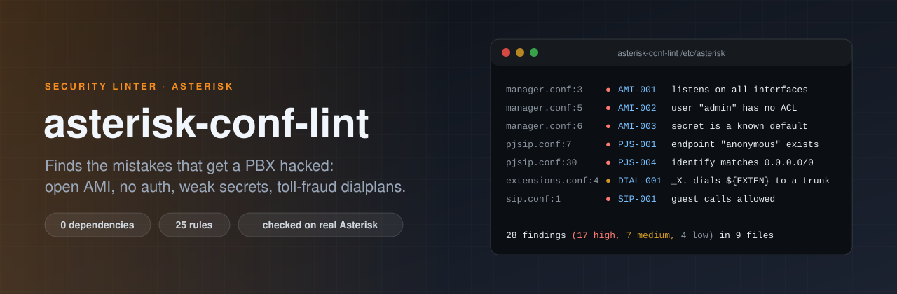

<p align="center">
  
</p>

<p align="center">
  <a href="https://github.com/ErenOzgu/asterisk-conf-lint/actions/workflows/ci.yml"></a>
  
  
  
  <a href="LICENSE"></a>
</p>

A linter for Asterisk configuration files. It reads `manager.conf`, `pjsip.conf`, `sip.conf`, `rtp.conf`, `http.conf`, `ari.conf`, `modules.conf`, `extensions.conf` and `asterisk.conf`, and reports the mistakes that get PBXes broken into: an AMI that listens on the internet, endpoints that need no password, `admin`/`admin`, a dialplan that dials any number for anyone.

Asterisk happily loads all of these. This tool tells you what it will not. It is a single static binary with **no third-party Go dependencies**, and it does not need Asterisk installed.

```text
$ asterisk-conf-lint /etc/asterisk
/etc/asterisk/manager.conf:3  high      AMI-001  AMI listens on all interfaces (bindaddr = 0.0.0.0)
    fix: Set bindaddr = 127.0.0.1, or a private address behind a firewall, and use TLS for anything that leaves the host.
/etc/asterisk/manager.conf:5  high      AMI-002  user "admin" has no deny/permit lines: any host that reaches the port may try to log in
/etc/asterisk/manager.conf:6  high      AMI-003  user "admin": the secret is a well-known default or guess
/etc/asterisk/pjsip.conf:7    high      PJS-001  endpoint "anonymous" exists: calls from unknown senders land in context "default"
...
28 findings (17 high, 7 medium, 4 low) in 9 files
```

The complete output for the deliberately broken configuration in [`testdata/bad`](testdata/bad) is in [`testdata/bad.golden.txt`](testdata/bad.golden.txt).

## Install

```bash
go install github.com/ErenOzgu/asterisk-conf-lint/cmd/asterisk-conf-lint@latest
```

or take a binary (Linux, macOS, Windows; amd64 and arm64) from the [releases](https://github.com/ErenOzgu/asterisk-conf-lint/releases). To build from a checkout: `go build ./cmd/asterisk-conf-lint`.

## Use

```bash
asterisk-conf-lint /etc/asterisk                       # a directory is searched for *.conf
asterisk-conf-lint pjsip.conf manager.conf             # or name files
asterisk-conf-lint -format sarif /etc/asterisk > lint.sarif
asterisk-conf-lint -fail-on high -disable SIP-005 .    # CI gate
asterisk-conf-lint -list-rules                         # every rule with its reasoning
```

Pass the **directory** if you split your configuration with `#include`: templates (`[tmpl](!)`) and `type = identify` sections are resolved across all files of the run.

| Flag | Default | |
|---|---|---|
| `-format` | `text` | `text`, `json` or `sarif` (GitHub code scanning reads SARIF) |
| `-fail-on` | `medium` | Exit status 1 when a finding is at least this severe: `info`, `low`, `medium`, `high`, `critical`, or `none` |
| `-min-severity` | `info` | Hide findings below this severity |
| `-disable` | | Rule IDs to switch off, comma-separated |
| `-check-perms` | off | Also report world-readable files that contain secrets (`CFG-003`) |
| `-no-color` | | No colour (also off when output is not a terminal or `NO_COLOR` is set) |

Exit status: `0` nothing at or above `-fail-on`, `1` findings, `2` usage or I/O error.

### Silence a finding on purpose

A comment on the same line, or the line above, hides a rule and documents why:

```ini
; lint-ignore: AMI-004 the exporter needs CoreStatus, which is in the system class
write = system,reporting
```

`; lint-ignore: *` hides everything on that line; `; lint-ignore-file: SIP-005` hides a rule for the whole file. The summary line counts what was suppressed, so ignores stay visible.

### In CI

```yaml
- name: Lint the Asterisk configuration
  run: |
    go install github.com/ErenOzgu/asterisk-conf-lint/cmd/asterisk-conf-lint@latest
    asterisk-conf-lint -fail-on high config/asterisk
```

To get findings into the repository's Security tab:

```yaml
- run: asterisk-conf-lint -fail-on none -format sarif config/asterisk > asterisk.sarif
- uses: github/codeql-action/upload-sarif@v3
  with:
    sarif_file: asterisk.sarif
```

## Rules

| Rule | Severity | File | What it catches |
|---|---|---|---|
| `AMI-001` | high | `manager.conf` | AMI listens on a non-loopback address |
| `AMI-002` | high | `manager.conf` | AMI user without a working ACL |
| `AMI-003` | critical | `manager.conf` | AMI user with a weak secret |
| `AMI-004` | high | `manager.conf` | AMI user with powerful write permissions |
| `ARI-001` | critical | `ari.conf` | ARI user with a weak password |
| `ARI-002` | low | `ari.conf` | ARI passwords stored in plain text |
| `CFG-000` | low | `all files` | Line the parser does not understand |
| `CFG-001` | high | `all files` | #exec directive in a configuration file |
| `CFG-002` | medium | `asterisk.conf` | execincludes is enabled |
| `CFG-003` | medium | `all files (needs --check-perms)` | Configuration file with secrets is readable by everyone |
| `DIAL-001` | medium | `extensions*.conf` | Catch-all pattern dials whatever it is given |
| `DIAL-002` | high | `extensions*.conf` | System() or SHELL() built from channel variables |
| `HTTP-001` | medium | `http.conf` | Built-in HTTP server on a non-loopback address without TLS |
| `MOD-001` | low | `modules.conf` | Legacy channel drivers are loaded but not configured |
| `PJS-001` | high | `pjsip.conf` | An endpoint named anonymous accepts unidentified callers |
| `PJS-002` | high | `pjsip.conf` | Endpoint without authentication |
| `PJS-003` | critical | `pjsip.conf` | auth section with a weak password |
| `PJS-004` | high | `pjsip.conf` | identify section that matches every address |
| `PJS-005` | high | `pjsip.conf` | Transport allows an outdated TLS or SSL version |
| `RTP-001` | medium | `rtp.conf` | strictrtp is switched off |
| `SIP-001` | high | `sip.conf` | chan_sip accepts guest calls |
| `SIP-002` | medium | `sip.conf` | chan_sip tells attackers which usernames exist |
| `SIP-003` | high | `sip.conf` | Peer skips authentication of INVITEs |
| `SIP-004` | critical | `sip.conf` | chan_sip peer with a weak secret |
| `SIP-005` | low | `sip.conf` | chan_sip is deprecated |
`asterisk-conf-lint -list-rules` prints, for every rule, why it matters and how to fix it. This table is generated from the same source, and a test fails if it goes out of date.

Severities follow what an attacker gets: **critical** is a login anyone can guess, **high** is a door that is open or unauthenticated, **medium** is a weakness that needs a second mistake, **low** is hygiene.

## What running it against a real Asterisk taught

The first version of the parser read the stock `/etc/asterisk` of Ubuntu's Asterisk 18 and 20 packages and was wrong in four ways. These are fixed and tested:

- **Keys can contain spaces.** `show channeltypes = core show channeltypes` in `cli_aliases.conf` is valid. The parser split at the first `=` and trimmed, as Asterisk does, instead of rejecting it.
- **Not every `.conf` is Asterisk syntax.** `ast_debug_tools.conf` is sourced by bash, `dbsep.conf` belongs to a Perl script and `muted.conf` to a separate utility. All three are skipped by name.
- **Asterisk stops at the first bad line.** `geolocation.conf` in the stock package has a stray block at line 310 and Asterisk answers `parse error: No category context for line 310`. The linter reports the first unreadable line of a file, with a count of the rest, which is the line that matters.
- **A `permit` without a `deny` restricts nothing.** The AMI access list allows every address that no rule mentions. `hack/real-asterisk.sh` proves it: a user with only `permit = 10.0.0.0/255.0.0.0` logs in from `127.0.0.2`.

## How it is tested

| What | How |
|---|---|
| Parser | Comments (`;`, `\;`, `;-- --;` blocks), `=` and `=>`, templates, directives, CRLF, 200 kB lines, bad lines |
| Every rule | Positive and negative cases, including the boundaries (11 vs 12 character secrets, `bindaddr` loopback in four spellings, `deny` of one network vs everything) |
| Output | A golden text file, JSON that parses, SARIF with consistent rule indexes and levels, exit codes of the CLI |
| Docs | The rule table in this README must equal `-list-rules -format markdown` |
| **Real Asterisk** | [`hack/real-asterisk.sh`](hack/real-asterisk.sh) starts Asterisk 18 (Ubuntu 22.04) and 20 (24.04) on the fixtures and checks the claims: the good configuration loads, AMI listens on loopback only and its ACL keeps `127.0.0.2` out; on the bad one AMI really listens on `0.0.0.0`, `admin`/`admin` logs in, chan_sip allows guests, `#exec` really runs, and every line Asterisk rejects is a `CFG-000` finding |

The configuration that [asterisk-gcp-iac](https://github.com/ErenOzgu/asterisk-gcp-iac) renders passes with one low finding, `AMI-004` for the exporter's `system` class (CoreStatus needs it).

## Limits

- **Static analysis.** It sees files, not a running system: realtime (database) configuration, `extensions.ael` and `extensions.lua` are invisible to it.
- **Heuristics.** `DIAL-001` looks for a catch-all pattern that dials `${EXTEN}` into a trunk with no `Authenticate()`, `GotoIf()`, `ExecIf()` or `GROUP()` before it. A check done in a called subroutine is not seen, so use `lint-ignore` with a reason.
- **Secrets.** It judges length, common passwords, repeats and sequences, not whether a password leaked.
- **PJSIP wizard** (`pjsip_wizard.conf`) and `type = registration` are not analysed yet.
- Rules reflect Asterisk 18 to 20 defaults. Check `-list-rules` before relying on one for another version.

## License

MIT, see [LICENSE](LICENSE).
